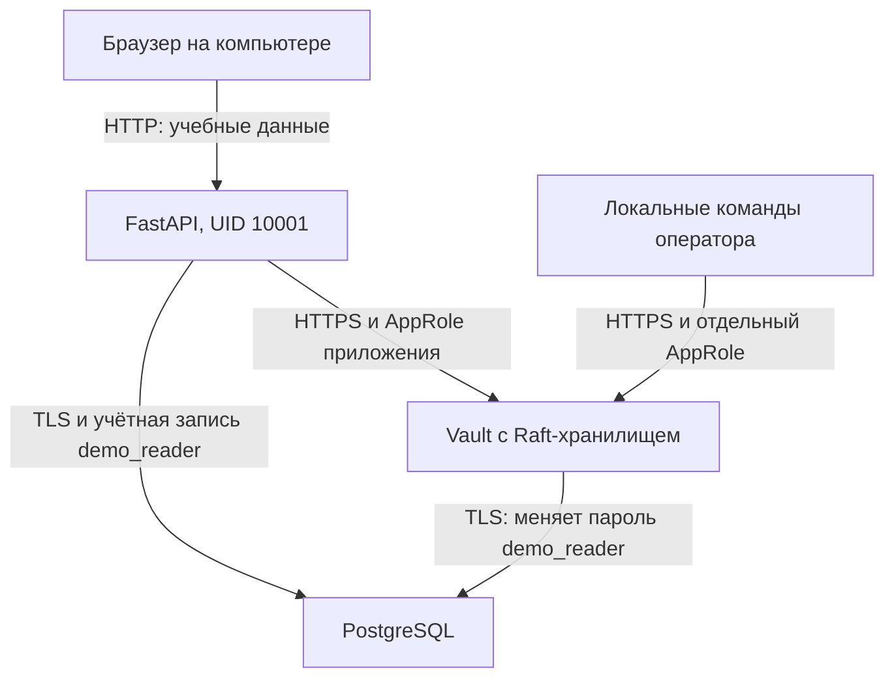

# Архитектура первого этапа

## Назначение

Подтвердить, что приложение получает секрет из отдельного защищённого
хранилища, а фактическая замена пароля в целевой системе не требует
пересборки или ручного перезапуска приложения.

## Компоненты и границы доверия

Контейнер приложения видит только собственные файлы AppRole и открытый
сертификат CA. Ключ разблокировки, ключ CA, начальные пароли и идентичность
оператора остаются вне контейнера приложения. Исходники не содержат
значений секретов: они генерируются на конкретной машине.

Приложение подключено к двум сетям: обычной bridge-сети `web` для публикации
HTTP-порта `127.0.0.1:8001` и изолированной сети `backend` для доступа к Vault
и PostgreSQL. Сервисы Vault, PostgreSQL и tools подключены только к `backend`.
Контейнер `demo` имеет исходящий сетевой доступ через `web`.
Проверка `/ready` внутри контейнера подтверждает работу зависимостей;
отдельная проверка CI обращается к опубликованному порту с хоста Docker.

## Разрешения

| Субъект | Разрешения |
| --- | --- |
| Приложение в Vault | `read database/static-creds/demo-db` |
| Оператор ротации в Vault | `update database/rotate-role/demo-db` |
| `demo_reader` в PostgreSQL | `CONNECT`, `USAGE demo`, `SELECT demo.documents` |
| `vault_db_manager` в PostgreSQL | `CREATEROLE`, право администрирования `demo_reader`, смена собственного пароля |
| Начальный администратор | Выполняет bootstrap; начальный root-токен Vault затем отзывается |

Менеджер БД не является superuser. Его `CREATEROLE` остаётся привилегированным
разрешением; хранение его пароля доверено только Vault. Vault меняет собственный
пароль подключения после регистрации, поэтому первоначальное значение менеджера
перестаёт действовать. У приложения нет доступа к конфигурации этого подключения.

## Порядок ротации

Сначала Vault изменяет пароль пользователя PostgreSQL через database plugin.
Затем потребитель получает актуальный пароль из Vault при новом подключении.
Если ротация попала в промежуток между получением пароля и подключением,
потребитель однократно повторяет чтение секрета и попытку подключения.
Операции с данными не воспроизводятся автоматически.

Учебный потребитель открывает новое соединение на каждый запрос. Для малого
стенда это упрощает доказательство ротации. При переходе к пулу соединений
потребуются обновление конфигурации пула и отдельное управление старыми сессиями.
Обещание отсутствия простоев при произвольных сбоях в этот этап не входит.

Интервал автоматической ротации `24h` выбран для демонстрации и не является
универсальной нормой. При раскрытии секрета выполняется немедленная ротация.
Обоснование рабочего интервала зависит от риска и назначения секрета.

## Аудит и конфиденциальность

Vault пишет журнал в отдельный постоянный том; `log_raw` отключён.
Чувствительные поля Vault по умолчанию обрабатываются механизмом HMAC.
Приложение не возвращает пароль или токен, а ошибки внешних систем
заменяются фиксированными сообщениями. Учебный отчёт содержит только
время и результаты проверок. Значения паролей испытание держит в памяти;
гарантированное обнуление памяти Python не заявляется.

## Ограничения учебного размещения

- Локальный однопользовательский стенд, один узел Vault и одна PostgreSQL.
- Ключ разблокировки хранится как один ключ с порогом 1 в отдельном локальном
  файле. Это упрощение для курсовой, без разделения полномочий хранителей ключей.
- AppRole SecretID не истекает автоматически в этой версии стенда, а токены
  доступа краткосрочны. Защита файлов начальной идентичности обязательна.
- Компрометация администратора компьютера или Docker даёт доступ к стенду.
- Сертификаты локального CA действуют год; их продление добавляется отдельно.
- `disable_mlock=true` используется с интегрированным Raft-хранилищем.
  Защита памяти и swap зависит от конфигурации хоста.
- PostgreSQL доступна только во внутренней сети Docker. Локальные Unix-сокеты
  внутри контейнера доверенные и нужны процедуре его первоначального запуска.
- Порты опубликованы только на `127.0.0.1`. HTTP демонстрационного сервиса
  возвращает только учебные документы. Пользовательской авторизации на этом
  этапе нет, поэтому размещение в интернете не предусмотрено.
- Журнал аудита пока не выносится на независимый сервер и не защищён от
  администратора хоста. Это локальный журнал, без заявления о неизменяемости.
- При раскрытии пароля нужен также анализ уже открытых сессий. Проверка
  отказа нового подключения со старым паролем не доказывает завершения прежних сессий.

## Что показывать на защите

1. Состав контейнеров через `docker compose ps`.
2. Два учебных документа через `/api/documents`.
3. Политики `demo.hcl` и `rotator.hcl` без значений секретов.
4. Команду испытания и успешный безопасный JSON-отчёт.
5. Повторное получение документов после ротации.
6. Сохранение конфигурации после перезапуска и разблокировки Vault.
