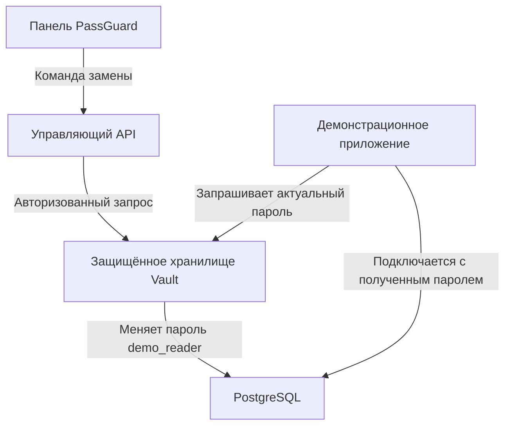

# Как работает PassGuard и как им пользоваться

PassGuard — учебная система управления секретами приложений. Её задача —
хранить служебные пароли отдельно от исходного кода, предоставлять их
разрешённому приложению, выполнять замену и помогать обнаруживать возможные
утечки в исходных файлах.

В панели текущей версии доступен один целевой секрет: пароль учётной записи
`demo_reader` в PostgreSQL. В Vault этот секрет связан с ролью `demo-db`.
Демонстрационное приложение использует эту учётную запись для чтения учебных
документов из БД. Панель показывает сведения о секрете и позволяет выполнять
операции с ним. Управляющий API имеет отдельную служебную учётную запись БД,
пароль которой также получает из Vault. Форма добавления произвольных паролей от сайтов, почты
и других личных аккаунтов в этой версии не реализована.

Пароли и ключи в стенде выполняют разные задачи:

| Что | Для чего используется | Как обрабатывается |
| --- | --- | --- |
| Пароль `demo_reader` | Подключение демонстрационного приложения к БД | Актуальное значение получает из Vault приложение; в PostgreSQL хранятся данные проверки пароля |
| Пароль пользователя панели, например `admin` | Вход человека в PassGuard | В управляющей БД хранится хеш Argon2id; личный пароль меняется в «Мой аккаунт» |
| Закрытые ключи сертификатов, например `ca.key` | Защищённое взаимодействие компонентов стенда | Служебные файлы локальной установки, отдельные от данных входа в панель |

Заменить пароль `demo-db` и сменить личный пароль администратора — две
самостоятельные операции. Они не меняют пароль друг друга.

На схеме показан основной рабочий сценарий:



Внутри системы работа происходит последовательно:

1. При первоначальной настройке создаются сертификаты, служебные учётные
   записи и правила доступа. Vault настраивается на управление паролем
   `demo_reader`; первоначальный root-токен Vault отзывается. Эти действия
   выполняются один раз при развёртывании, а не перед каждым входом в панель.
2. Демонстрационное приложение обращается к Vault под собственной служебной
   идентичностью и получает актуальные имя пользователя и пароль.
3. Приложение подключается к PostgreSQL и читает `demo.documents`. Доступ
   этой учётной записи ограничен чтением учебных документов.
4. Для ручной замены администратор отправляет команду через панель. API
   проверяет сессию, роль и CSRF-токен, фиксирует операцию и обращается к Vault.
5. Vault выполняет фактическую замену пароля в PostgreSQL и предоставляет
   обновлённое значение разрешённому потребителю. Это изменение работающей
   учётной записи, а не только записи в интерфейсе.
6. При следующем подключении демонстрационное приложение получает актуальный
   пароль из Vault. В учебном сервисе новое соединение открывается на каждый
   запрос, поэтому пересборка и ручной перезапуск приложения для ротации
   не нужны. Если пароль изменился между чтением и подключением, выполняется
   одна повторная попытка с новым чтением секрета.

Учебный интервал автоматической ротации — 24 часа. В панели он отображается
как период замены, например «1 дн.». Это настройка данного стенда;
ручную замену администратор может выполнить отдельно.

Для повседневного запуска уже настроенного стенда открой PowerShell
в корне рабочей копии, где находится `compose.yaml`:

```powershell
docker compose up -d postgres vault
docker compose run --rm tools python -m scripts.unseal
docker compose up -d --wait demo control
```

После перезапуска Vault может потребоваться разблокировка: `scripts.unseal`
использует запись восстановления этой установки. Если Vault уже разблокирован,
команда сохраняет его рабочее состояние. Первоначальную настройку заново
выполнять не требуется. Когда панель уже работает, можно сразу переходить
к действиям ниже.

Порядок работы в панели:

1. **Войди в PassGuard.** Открой <http://127.0.0.1:8000/> и введи логин
   и актуальный пароль своей учётной записи. Для самого первого входа
   администратор получает данные из `.local/operator/control-admin.json`.
   После смены личного пароля применяется новый пароль; файл первого входа
   автоматически не обновляется.
2. **Посмотри обзор.** Здесь показаны доступность хранилища и управляющей БД,
   количество управляемых секретов, период ротации и последние проверки.
   «0 находок» относится к последней проверке исходников, а не ко всем файлам
   на компьютере. Кнопка проверки демонстрационного приложения отдельно
   подтверждает доступность потребителя секрета.
3. **Открой «Секреты».** Карточка «Демонстрационная база» показывает
   идентификатор `demo-db`, учётную запись `demo_reader` и период замены.
   Значение пароля в браузер не передаётся. Для приложения получение пароля
   выполняется через его служебный доступ к Vault.
4. **Выполни замену пароля.** Под ролью администратора нажми «Заменить пароль»,
   выбери причину и нажми «Подтвердить замену». После подтверждения Vault
   панель покажет «Пароль заменён». Затем нажми «Проверить приложение»:
   ожидается «Приложение доступно». Если ответ о ротации потерян, используй
   статус текущей операции и повтор с тем же идентификатором; новая ротация
   автоматически не запускается.
5. **Проверь исходники.** Открой «Проверка исходников», выбери ZIP и нажми
   «Проверить исходники». Внутри архива должны быть выбранные исходные файлы
   без `.git`, `.local`, `.venv` и `node_modules`. Основные лимиты:
   5 МиБ на ZIP, 1000 файлов, 1 МиБ на отдельный файл и 20 МиБ после распаковки.
6. **Разбери отчёт.** Для находки показаны путь, строка, тип и правило
   обнаружения. Значения из содержимого файлов и фрагменты исходников
   в отчёт не включаются. Совпадение требует проверки человеком. Пропущенные
   бинарные файлы и неподдерживаемые кодировки перечислены отдельно.
   Кнопка «Скачать JSON» сохраняет очищенный отчёт.
7. **Проверь журнал.** В «Журнале действий» доступны входы, замены пароля,
   проверки, изменения доступа и отказы API. Открой «Подробнее» для сведений
   о конкретном событии. Замена через панель фиксируется управляющим API;
   обращения непосредственно к Vault учитываются в его отдельном аудите.
8. **Настрой доступ.** В разделе «Пользователи» администратор создаёт учётные
   записи, назначает роли и отключает доступ. При смене роли или отключении
   сессии соответствующего пользователя отзываются. Личный пароль меняется
   в «Мой аккаунт»; после этого нужно войти повторно. Для завершения работы
   используй кнопку выхода в правом верхнем углу.

Роли соответствуют задачам пользователя:

| Роль | Что может делать |
| --- | --- |
| Администратор | Читать метаданные и отчёты, менять пароль demo-db, запускать проверки, читать журнал, управлять пользователями |
| Оператор | Читать метаданные и отчёты, проверять исходники и доступность демонстрационного приложения |
| Аудитор | Читать метаданные, отчёты и журнал |

Каждая роль может менять собственный пароль и завершать свою сессию.
Ограничения проверяются API независимо от того, какие кнопки показаны в панели.

Чтобы увидеть поиск секрета на понятном примере, создай отдельную учебную
папку и файл `config.py` с такой строкой:

```python
DB_PASSWORD = "TRAINING_NOT_REAL_2026"
```

Это специально подготовленная строка для демонстрации; она не используется
для входа в какую-либо систему. Упакуй `config.py` в ZIP и загрузи его через
панель. Ожидается находка строкового пароля с указанием первой строки.
После удаления учебной строки создай новый ZIP и повтори проверку, чтобы
сравнить два отчёта. Архив с файлами пользователя временно обрабатывается
в изолированном сканере без доступа к Vault и БД; загруженный код не исполняется.

Обнаружение секрета не заменяет его отзыв у сервиса, который этот секрет
принимает. Для настоящей утечки нужно проверить находку, заменить или отозвать
раскрытые учётные данные, обновить разрешённых потребителей и убрать секрет
из исходников. Если секрет опубликован в Git, отдельно проверяется история:
проверка ZIP в текущей версии анализирует только переданный снимок файлов.
Встроенная кнопка ротации выполняет замену именно `demo-db`; для ключа
постороннего сервиса потребуется операция у этого сервиса.

Для полного испытания замены пароля выполни из рабочей папки проекта:

```powershell
docker compose run --rm tools python -m scripts.verify_rotation
```

Команда сама выполняет ещё одну учебную ротацию. Она проверяет работу
приложения до замены, отказ старому паролю в новом соединении, приём нового
пароля и пять успешных запросов к приложению после замены без его перезапуска.
Также проверяются ограничения прав. При успехе выводится `status: passed`,
а безопасный отчёт сохраняется в `reports/rotation.json`.

Текущую работу потребителя можно увидеть в браузере:
<http://127.0.0.1:8001/api/documents>. До и после замены должны возвращаться
те же учебные документы. Кнопка «Проверить приложение» подтверждает
доступность, а проверку отказа старому паролю выполняет именно испытательный
скрипт. Смена пароля PostgreSQL сама по себе не завершает ранее открытые
соединения — поэтому в испытании создаются новые подключения.

Для демонстрации курсовой достаточно последовательно показать получение
документов, замену пароля через панель, работу потребителя после замены,
обнаружение учебной строки в ZIP, ограничения роли аудитора и журнал действий.
Отчёт `rotation.json` дополняет показ доказательством отказа старому паролю.

Подробности: [панель и операции](panel.md), [ограничения сканирования](source-scanning.md),
[протокол проверок](verification.md).
